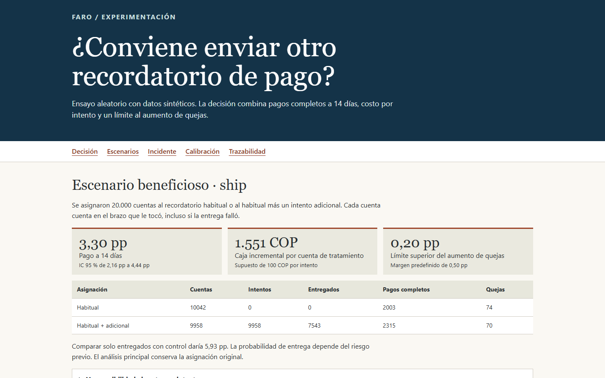

# Payment reminder experiment

**Data Science** · Simulated accounts and costs in Colombian pesos (COP) · [Español](README.es.md) · [Portfolio](https://github.com/jorgealarcon07#projects)

   

## Is an extra payment reminder worth sending?

I built an A/B experiment for a fictional operations team. It measures payment within 14 days, the cost of the extra reminder and complaints. The report recommends whether to send the reminder based on the full set of outcomes and the quality of the underlying data.

**Measured result.** In a favorable scenario with 20,000 simulated accounts, the difference was **+3.30 percentage points** in the group assigned to receive the reminder (95% CI **+2.16 to +4.44**). Removing 3,250 outcomes invalidated the analysis and blocked the recommendation.

[Case study](CASE_STUDY.md) · [Open interactive report](https://jorgealarcon07.github.io/jorgealarcon07/experimento-de-recordatorios/index.en.html) · [Architecture (Spanish)](docs/ARQUITECTURA.md)



## How it works

Python assigns accounts at random. The pipeline uses PostgreSQL to keep the assignments and event history, waits for the outcome window to close and checks that records are complete. SciPy and statsmodels support quality checks and estimates. The analysis keeps accounts in their assigned group even if the reminder failed to reach them. A set of 5,000 Monte Carlo replications checks how the decision rule behaves across five simulated scenarios.

[Protocol](experiment_protocols/v1.json) · [Scenario decisions](reports/release/decisions.csv) · [English walkthrough transcript](assets/web/walkthrough.en.txt) · [Data and licensing notes (Spanish)](DATA_SOURCES.md) · [CI runs](https://github.com/jorgealarcon07/faro-experiment-lab/actions)

## Run the synthetic demo

Use Python 3.12 and a dedicated PostgreSQL 17 database. Configure the connection from [.env.example](.env.example). The database user needs permission to create the project schema. Run from the repository root in PowerShell. On Linux or macOS, use `. .venv/bin/activate`.

```powershell
py -3.12 -m venv .venv
.\.venv\Scripts\Activate.ps1
python -m pip install -r requirements.lock
python -m pip install --no-build-isolation --no-deps -e .
python -m pip check
faro-exp demo
faro-exp validate --out local/demo
```

Open `local/demo/index.html`. The [full guide in Spanish](README.es.md) covers the isolated PostgreSQL runner, the missing-outcome incident and the Monte Carlo replay.

Both report languages share the same evidence files. The [saved English report](reports/release/index.en.html) also opens from a local checkout.
