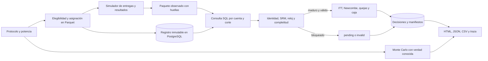

# Arquitectura, contratos y estimandos

El simulador conoce las probabilidades generadoras. El analizador recibe el protocolo, las asignaciones registradas y paquetes observados. Los tests comprueban que el módulo de análisis no importa el simulador. En cada experimento de la demo se escriben y registran las asignaciones antes de crear resultados. La CLI permite ejecutar esas fases por separado. El estimador científico se comparte entre el análisis de cuentas y el muestreo Monte Carlo de conteos suficientes.

## Archivos y grano

| Contrato | Clave y campos decisivos | Comprobación |
|---|---|---|
| eligible | Experimento + cuenta, saldo entero en COP, elegibilidad, riesgo previo, measured_at | Una obligación por cuenta. Medición anterior a asignación, saldo 50.000 y elegibilidad verdadera. |
| assignment | Experimento + cuenta, brazo C/T, probabilidad y assigned_at | Mismas claves que elegibilidad, una asignación, 50/50 y fecha de inicio registrada. El experimento rechaza una inscripción distinta. |
| recorded | Copia de asignaciones que llega a la ruta de medición | Se contrasta fila a fila contra el registro autorizado. Las pérdidas y cambios de variante quedan visibles. |
| outcome | Experimento + cuenta, paid, complained, window_end, available_at | Binarios explícitos sobre pago completo y queja en el horizonte de 14 días. El analizador observa la fila al llegar available_at. Un ausente sigue ausente. |
| event | Recibo por event_id, cuenta, attempted_at, received_at y estado delivered/failed | Un intento adicional por tratado, cero en control. Redelivery con nueva hora de recepción conserva el intento. Conflictos de cuenta, estado u hora de intento bajo el mismo ID bloquean. |
| run_manifest | ID de ejecución, huellas de protocolo, inscripción, lote y tabla ITT, semilla, corte, fuente, entorno y parent_run | Huellas SHA-256, campos de contrato, linaje dentro del mismo experimento y tiempo no decreciente. |
| decision_record | Estado, razones, conteos, controles, estimaciones, escenarios de costo y rol responsable ficticio | Los estados bloqueados suprimen estimaciones y segmentaciones de eficacia. |

Los formatos son Parquet con Zstandard para tablas y JSONL para recibos. La forma y tipos de cada columna se validan antes de COPY. La firma lógica del protocolo se obtiene del JSON canónico. El manifiesto de publicación asocia cada nombre permitido con los bytes de su archivo. Las huellas comprueban integridad en una distribución de confianza. Los outcomes expresan un resumen al horizonte. Un uso real necesitaría auditar además cómo el libro de pagos produjo ese resumen. [Contratos de entrada y salida](../contracts/v1) · [Huellas](../contracts.lock.json)

## Controles previos al estimador

La consulta parte del registro de asignaciones, agrupa cada fuente por cuenta antes de unir y mantiene las cuentas sin resultado o sin entrega. Se cuentan por separado recibos de transporte, intentos de negocio, pagos y denominadores. Se conserva una huella de la tabla ordenada por ID para cada ejecución. El registro, el log observado y la unión madura se contrastan con el reparto 50/50 mediante chi-cuadrado de Pearson con un grado de libertad. El umbral SRM es 0,001. La integridad también exige ausencia de huérfanos, duplicación de outcomes, cruce de variantes y relojes imposibles. Una pérdida equilibrada puede pasar SRM y fallar en completitud. [SQL de la tabla analítica](../src/faro_exp/itt.sql)

Todas las horas del experimento son UTC y simuladas. La fecha de asignación es el 1 de enero de 2026 a las 00:00. El resultado resume hasta el día 15 a las 00:00 y el cierre de recepción ocurre el día 17 a las 00:00. Una fila visible antes de su window_end es incompatible. Los artefactos del simulador pueden contener datos posteriores al corte. El SQL filtra por disponibilidad antes de construir la tabla evaluable. El reporte de un corte temprano no contiene efectos ni resultados de subgrupos.

## Cálculos y decisión

- La diferencia ITT es pagos_T / n_T menos pagos_C / n_C. La misma fórmula aplica a quejas. El intervalo bilateral al 95 % usa los límites Wilson de ambos brazos combinados por Newcombe. Los tests comparan statsmodels con una implementación independiente de la fórmula, incluidos éxitos cero y extremos.
- El negocio fija un umbral mínimo de 0,01 en probabilidad absoluta. El límite inferior del IC de pago debe superarlo estrictamente.
- La caja incremental por cuenta tratada es 50.000 × diferencia ITT − costo del intento. Como todos los tratados requieren un intento, la entrega fallida conserva ese costo. El cálculo transforma ambos extremos del IC y explora 0, 100 y 250 COP por intento. Con estos supuestos, superar el mínimo de pago ya cubre el costo base. Mantener el criterio de caja explícito permite auditar el supuesto y su sensibilidad.
- El límite superior del IC de aumento de quejas debe ser estrictamente inferior a 0,005. Eventos adversos escasos pueden dejar evidencia insuficiente aun cuando las tasas parezcan similares.
- El análisis principal adquiere estado terminal solo después del horizonte y margen de llegada. El análisis por riesgo es descriptivo. No hay análisis secuencial de eficacia ni corrección por subgrupos utilizada para promover.

## Monte Carlo

Cinco escenarios incluyen A/A, beneficio, perjuicio, más quejas y MDE. Para cada uno se simulan 1.000 ensayos de 20.000 cuentas con un número tratado binomial. Condicionando en el tamaño del brazo, una cuenta tiene riesgo y entrega independientes entre cuentas. Al integrar esos estados, cada pago es Bernoulli con probabilidad marginal 0,20 en control y 0,20 + efecto ITT en tratamiento. La queja es independiente del pago dado el brazo. Por ello pueden muestrearse directamente los conteos por brazo sin escribir 100 millones de filas. Los tests comprueban esa equivalencia por estrato. El ensayo de producto sí materializa los eventos, cuentas, relojes y fallos de instrumentación.

La raíz 20261122 y el índice de escenario generan 1.000 subflujos de NumPy independientes por escenario. El CSV identifica subflujo y réplica. Las métricas puramente estadísticas incluyen todas las réplicas, incluso si se bloqueó su uso operativo por SRM. También se publican tasas condicionadas a pasar SRM. La frecuencia de ship usa las 1.000 en el denominador. Para una tasa r, el error estándar Monte Carlo es √[r(1−r)/1.000]. El error del sesgo usa la desviación de las estimaciones dividida por √1.000. Una tasa observada cero tiene error plug-in cero y sigue admitiendo incertidumbre finita. [Resultados completos](../reports/release/monte_carlo.json)

## Persistencia

Un esquema PostgreSQL por producto conserva el registro, las instantáneas crudas y las ejecuciones. La inscripción tiene bloqueo transaccional por experimento y FK cuenta-asignación. La evaluación adquiere bloqueo por experimento y lote, usa COPY parametrizado en una transacción y publica decisión y manifiesto juntos. El ID estable combina experimento, protocolo, lote, corte, padre y versión de análisis. Repetir la solicitud devuelve el dictamen persistido. Tras una evaluación válida terminal, otra tabla ITT diferente en ese experimento se rechaza. La reparación de un incidente crea una ejecución nueva con parent_run. [Migración](../src/faro_exp/store.sql) · [Runbook](RUNBOOK.md)
